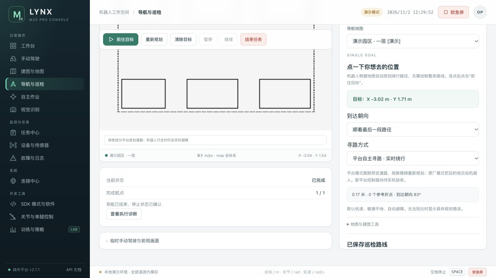

# M20 Pro 操作平台

本地安装视频依赖、首次连接及换 Wi-Fi 的操作见 [本地连接与视频说明](docs/local-connection-and-video.md)。已配置的机器人换网后，只需填写新 AOS 地址，平台继续严格核对原主机身份并恢复已有通道。

面向 Deep Robotics M20 Pro 的可视化控制与开发平台，整合连接、手动驾驶、相机、YOLO、建图与地图包、导航、自主探索、SDK 软件和训练任务管理。

初始协作快照与来源清单保留在 [PLATFORM_GUIDE.md](PLATFORM_GUIDE.md)、[docs/source-snapshot.json](docs/source-snapshot.json)。

当前为持续开发版本。已完成部分近距离实机测试和离线闭环验证，**不代表整层无人值守、复杂地形或长期隧道任务已经验收**。具体能力与限制见 [功能状态](docs/feature-status.md)。



图中为合成地图与模拟遥测，不是现场地图或实机画面。

## 快速启动

控制电脑使用 Python 3.9+。先启动独立演示，无需连接机器人：

```bash
git clone https://github.com/gaoyueyang0820/m20pro-platform.git
cd m20pro-platform
python3 m20_platform.py --demo --http 8088 --data-dir .dev/demo
```

打开 <http://127.0.0.1:8088/>。Mac 可使用 `启动平台.command`；Windows 参见 [README-Windows.md](README-Windows.md)。默认网页和三维资源已打包，日常使用无需 Node、npm 或 ROS。

视频和点云算法需要 NumPy、OpenCV。使用独立环境：

```bash
python3 -m venv .venv
source .venv/bin/activate
python -m pip install -r requirements-dev.txt
python tools/build_native_sensing.py
python m20_platform.py --demo --http 8088 --data-dir .dev/demo
```

Windows 激活环境使用 `.venv\Scripts\activate`。原生点云加速需本机 C++ 编译器；没有可用原生库时使用 NumPy，不能复制 Mac 的 `.so` 到机器人。YOLO 完整推理依赖另见现有人员识别安装脚本；可移植检查不要求安装训练环境。

## 连接与主机分工

电脑与机器人需要网络可达。连接中心保存 AOS 外部入口，并经 AOS 中转访问 NOS/GOS；机器人侧首次部署需具备相应权限。

- **电脑平台**：界面、任务调度、探索目标选择、全局规划、局部轨迹控制和 YOLO。
- **NOS/GOS 平台服务**：读取机器人感知，提供地图、SDK 等适配接口；NOS 执行地图融合与候选保存。
- **原厂系统**：平衡、腿轮、步态、电机执行、SLAM 和定位；原厂单点导航仍作为独立选项保留。

Wi-Fi 更换后，AOS 外部 IP 可能改变；机器人内部 NOS/GOS 地址通常不随外网改变。本机 `127.0.0.1:8080` 不变。共享给同一私人网络的电脑时，可使用：

```bash
python m20_platform.py --ip <AOS-WIFI-IP> --share <PRIVATE-CIDR>
```

共享地址取决于控制电脑的局域网 IP，更换网络后需更新入口与共享网段。同一工作区只启动一个后台，避免本机和共享服务争用机器人；独立测试使用其他 `--data-dir`。

## 当前功能

| 模块 | 内容 |
|---|---|
| 手动驾驶 | 方向、步态、三轴控制、停止、前后相机与状态反馈 |
| 地图 | 原厂建图、点云/栅格查看、地图包导入导出、版本与活动地图管理 |
| 自主探索 | 边界信息收益选点、连续轨迹跟踪、有界退让、停车与保存 |
| 原图续建/更新 | 保存本轮观测，结构配准后与完整旧图融合；变化证据不足时保留观测并明确待补 |
| 单点导航 | 任意角/机身约束规划、临时通行观测层、平台执行器或原厂导航 |
| 视觉 | 人员检测与跟随、人数轨迹统计、安全帽/PPE 检测 |
| 开发 | SDK 连接/进程、关节与单腿预览/控制入口、训练工作站适配 |

临时通行层只处理有实测证据的近域变化，不改写永久地图。定位失效、旧帧过期、新障碍或连接变化不能靠界面平滑掩盖。新地图候选由操作者手动启用。

## 开发与验证

```bash
python tools/check_portable.py
```

该检查可在协作者电脑和 CI 运行，不使用机器人或私有现场数据。包含机器人记录的严格本机验收另用 `tools/offline_acceptance.py`，缺少私有材料时应明确报告未完整验证。详见 [验证说明](docs/verification.md)。

修改三维资源时使用 `npm ci` 和 `npm run build`。接口见 [API.md](API.md)，结构见 [架构说明](docs/architecture.md)，协作流程见 [CONTRIBUTING.md](CONTRIBUTING.md)。

## 模型与来源

仓库保留已有人员、安全帽与人数统计模型；文件哈希、来源和已知许可范围见 [models/sources.json](models/sources.json) 及同目录许可文件。用户提供的 YOLO12n 权重没有发行版本/许可元数据，未将其标成已核实的官方下载版本。

探索、规划和地图更新参考了 explore_lite、Nav2、KISS-ICP 等项目的方法，具体版本、独立实现范围和许可说明见 [算法来源](reference/autonomy-v3-sources.md)。平台不是这些完整系统的直接移植，也没有训练一个新模型来替代原厂运控。

运行配置、令牌、私钥、真实地图、视频和现场回放不进入 Git。开发记录采用源码、合成夹具、测试结果和提交历史，不依赖原作者电脑路径。
