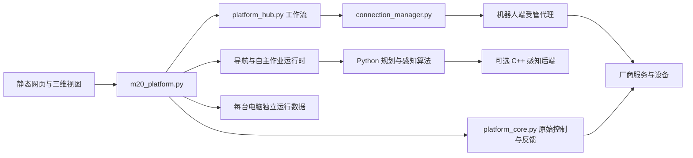

# 平台结构与协作边界

平台由电脑上的 Python 服务和静态网页组成，机器人侧保留厂商运控、SLAM/定位/规划服务。源码可以跨开发机协作；连接配置、运行状态与现场地图不属于源码。

## 电脑端

| 层 | 主要文件 | 修改时需要保留的边界 |
|---|---|---|
| HTTP 与状态组合 | `m20_platform.py`、`m20/platform_hub.py`、`m20/operations.py` | 后台任务是否接受、完成或被取消分别报告；不把 ACK 当作动作完成 |
| 原始通信与控制时钟 | `m20/platform_core.py`、`m20/m20_console.py` | 观察时效、命令失效与真实停止反馈不能被页面缓存代替 |
| 点目标和局部行走 | `m20/navigation_planner.py`、`m20/point_navigation.py`、`m20/local_trajectory.py` | 原厂执行与平台执行分别维护控制归属，规划预览不等于已执行 |
| 自主探索 | `m20/autonomy_runtime.py`、`m20/autonomy_core.py`、`m20/exploration_frontiers.py` | 未知区探索、旧区复查、地图保存与重新启用是不同阶段 |
| 定位恢复与显示 | `m20/localization_runtime.py`、`m20/localization_recovery.py`、`m20/pose_monitor.py` | 新帧独立验证与显示平滑分开；显示位置不能替换控制使用的原始定位 |
| 地图更新 | `m20/map_fusion.py`、`m20/map_refinement.py`、`m20/map_registration.py`、`m20/map_change_policy.py`、`m20/map_visibility.py` | 保存观测、生成候选和启用候选分开；不能把配准偏差直接解释为环境变化 |
| 视频与视觉 | `m20/camera_streams.py` 及视觉模块 | 图像新鲜度、检测结果与运动控制权分开；不重复打开无用的取流链路 |
| 页面 | `platform_web/`、`platform_web/viewer-src.js` | 前端脚本有加载顺序和缓存版本；保留其他页面的状态所有权与迟到结果失效处理 |

`platform_web/vendor/viewer.js` 由 `npm run build` 生成。Node 主要服务于构建与前端回归，运行控制台不需要 Node 或 ROS。

## 机器人代理与职责

`m20/connection_manager.py` 管理已有授权范围内的连接与代理，不是机器人运控的替代品。AOS 承担厂商运控/基础协议，NOS 承担建图、定位、规划和地图管理，GOS 面向用户应用；SDK 执行环境按设备已核实的部署配置确定。不要把“普通遥控模式”和“底层 SDK 模式”合并成一个开关。

原厂导航由机器人完成规划和控制；GOS 机载寻路在 GOS 完成全局规划、短程绕行和轨迹跟踪。电脑平台提交任务、显示反馈、运行离线回放并通过连接中心更新服务。自主探索目前仍由电脑平台规划，使用机内处理的雷达观测。任务建议接口位于平台，独立于运动执行。

`bridge/ros_sensors.py` 与感知代理读取 ROS2 数据，`bridge/mapping_job.py` 记录厂商采集/保存及后续融合结果，SDK/训练代理有独立职责。PC 上的测试替身、演示目录和 ROS 消息样例均不能证明代理在某台真机上已正确部署。

地图更新应保留完整原图、原始观测、相关栅格与历史来源。证据不足时可以保留观测并明确说明候选尚未生成；不能显示为丢失采集，也不能把未验证候选自动设为活动地图。

## 可选原生感知模块

`native/sensing.cpp` 通过 C ABI 1 供 `m20/native_sensing.py` 调用。它仅做完整点集的数学归约，不包含 ROS、网络、线程或执行器接口。正常数据走原生实现；数值边界、退化输入、缺库或 ABI 不符会显式回退，由 NumPy 实现保持判定行为。

构建是显式操作。可移植检查每次在临时目录编译当前源码，再验证完整输出一致性与原生调用计数，不使用工作区残留的库冒充新构建。

## OS 差异

| 平台 | 可共同使用的部分 | 需要单独处理的部分 |
|---|---|---|
| macOS | Python 控制台、网页、几何算法、Node 测试、本机 C++ 构建 | Shell/启动方式；严格本机验收使用系统网络沙箱，不能把它当作其他 OS 的能力 |
| Linux | 同一电脑端源码、便携测试、本机 C++ 构建 | 只有机器人侧或明确配置的环境才具备 ROS、systemd、厂商工具、GPU 训练栈 |
| Windows | Python/Node 纯算法与 UI 子集，独立演示与专用 Windows 安装说明 | POSIX 锁、SSH/服务管理、符号链接权限、视频与原生库工具链要分开验证；Windows C++ 数值一致性另由独立 MSVC CI 作业核对 |

平台间共享代码，不共享虚拟环境或已编译库。编译器、CPU 架构、Python/NumPy/OpenCV 版本和执行的测试范围，应随验证报告记录。

## 数据与证据

运行目录保存连接信息、会话、观测、地图、缓存和日志，应为每台设备独立维护。开发演示使用显式 `--demo --data-dir`，CI 使用只含被审查源码的临时副本。

真实现场回放与合成用例分别归档。便携 CI 不读取真实回放 JSON、模型权重或作者机器上的资料目录；缺少这些资料不会通过伪造夹具来“补全”。详见 [验证层级](verification.md)。
